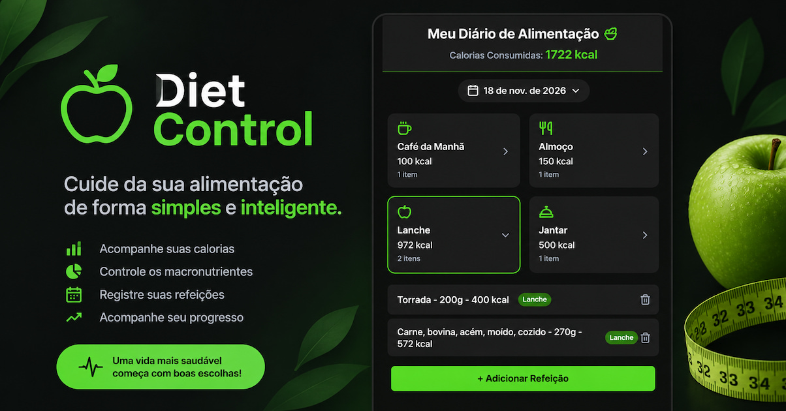

# 🍃 Diet Control

Aplicação web progressiva (**PWA**) para controle diário de alimentação, calorias e macronutrientes, com busca instantânea na **Tabela TACO** e fallback automático via **Open Food Facts**.



🔗 **Acesse em produção:** [diet-control-theta.vercel.app](https://diet-control-theta.vercel.app/)  
🌐 **Espelho GitHub Pages:** [gabriel491.github.io/Diet-Control](https://gabriel491.github.io/Diet-Control/)

---

## ✨ Funcionalidades

- **Painel de Meta Diária:** anel de progresso circular em SVG, barra de porcentagem, contador de calorias restantes (ou excedentes) e modal dedicado para definir ou editar a meta a qualquer momento.
- **Cálculo de Macronutrientes:** soma automática de **Proteínas, Carboidratos, Gorduras e Fibras** do dia, exibindo gramas totais e percentual aproximado sobre o consumo calórico.
- **Busca Híbrida de Alimentos:**
  1. Consulta instantânea e offline na **Tabela TACO** local (com normalização de acentos e busca por múltiplas palavras).
  2. Fallback automático na API pública do **Open Food Facts** caso o alimento não conste na base local.
- **Cálculo Proporcional por Grama:** atalhos rápidos (`50g`, `100g`, `150g`, `200g`) ou peso personalizado com recalculo em tempo real de calorias e macros.
- **Cadastro Manual:** registro direto de alimentos customizados com peso, calorias e macronutrientes opcionais.
- **Organização por Data e Refeição:** seletor de datas e filtro por categorias (**Café da Manhã**, **Almoço**, **Lanche** e **Jantar**).
- **Instalável no Celular (PWA):** suporte a instalação na tela inicial (Android e iOS) com funcionamento offline via Service Worker.
- **Persistência Local:** histórico de refeições e meta diária salvos automaticamente no `localStorage`.

---

## 🛠️ Tecnologias Utilizadas

- **[React](https://react.dev/)** — construção da interface e gerenciamento de estado
- **[Vite](https://vitejs.dev/)** — bundler e ambiente de desenvolvimento
- **[Tailwind CSS](https://tailwindcss.com/)** — estilização responsiva *mobile-first* em tema escuro
- **[Lucide React](https://lucide.dev/)** — biblioteca de ícones
- **[vite-plugin-pwa](https://vite-pwa-org.netlify.app/)** — manifesto, Service Worker e cache offline
- **Tabela TACO (JSON local)** + **[Open Food Facts API](https://world.openfoodfacts.org/)** — dados nutricionais

---

## 📂 Estrutura do Projeto

```text
Diet-Control/
├── public/
│   ├── diet-control-og.jpg       # Imagem de preview Open Graph (1200x630)
│   ├── favicon.svg               # Ícone vetorial da aplicação
│   └── ...                       # Ícones PWA e favicons
├── src/
│   ├── components/
│   │   ├── CardsCategorias.jsx   # Cards de Café da Manhã, Almoço, Lanche e Jantar
│   │   ├── Header.jsx            # Cabeçalho com identidade visual
│   │   ├── ListaVazia.jsx        # Listagem de alimentos registrados e estado vazio
│   │   ├── ModalMeta.jsx         # Modal para definir e editar a meta calórica
│   │   ├── ModalRefeicao.jsx     # Modal com busca híbrida e cadastro manual
│   │   ├── ResumoDiario.jsx      # Anel de calorias, barra de meta e cards de macros
│   │   └── SeletorData.jsx       # Navegação entre dias registrados
│   ├── constants/
│   │   └── categorias.js         # Metadados, nomes, cores e ícones das categorias
│   ├── data/
│   │   └── taco.json             # Base nutricional local (Tabela TACO)
│   ├── App.jsx                   # Estado principal e composição da tela
│   └── main.jsx                  # Ponto de entrada React
├── index.html                    # Metatags de SEO, Open Graph e Twitter Card
└── vite.config.js                # Configuração do Vite, PWA e base path multi-host
```

---

## 🚀 Como Executar Localmente

Pré-requisito: [Node.js](https://nodejs.org/) (v18 ou superior).

```bash
# 1. Clone o repositório
git clone [https://github.com/gabriel491/Diet-Control.git](https://github.com/gabriel491/Diet-Control.git)

# 2. Acesse a pasta do projeto
cd Diet-Control

# 3. Instale as dependências
npm install

# 4. Inicie o servidor de desenvolvimento
npm run dev
```

---

## 📦 Build e Deploy

O `vite.config.js` identifica automaticamente o ambiente de build via `process.env.VERCEL`, permitindo manter **Vercel** (`base: "/"`) e **GitHub Pages** (`base: "/Diet-Control/"`) sincronizados a partir do mesmo código.

```bash
# Gerar build de produção local
npm run build

# Publicar na Vercel (deploy automático pela branch main)
git push origin main

# Publicar no GitHub Pages
npm run deploy
```

---

## 📱 Instalação como App (PWA)

- **Android (Chrome):** acesse o link em produção, toque no menu `⋮` e selecione **Instalar aplicativo**.
- **iOS (Safari):** acesse o link, toque em **Compartilhar** e selecione **Adicionar à Tela de Início**.

---

## 👨‍💻 Autor

Desenvolvido por **Gabriel Macêdo** — [@gabriel491](https://github.com/gabriel491)