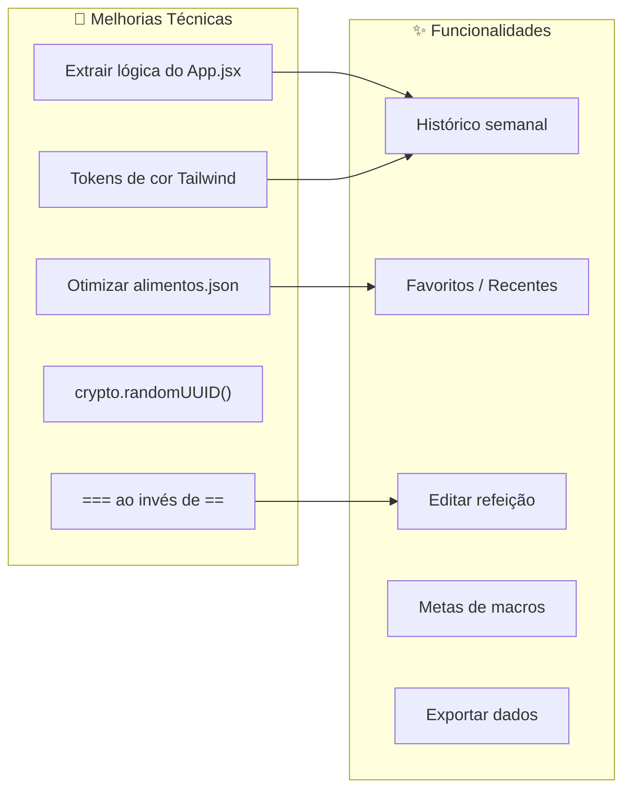

# 🔍 Análise Completa — Diet Control

## Visão Geral do Projeto

| Item | Detalhe |
|---|---|
| **Stack** | React 19 + Vite 8 + Tailwind CSS 4 + Lucide Icons |
| **Tipo** | PWA (Progressive Web App) com `vite-plugin-pwa` |
| **Dados** | Base local unificada (TACO + TBCA + IBGE/POF) + fallback Open Food Facts API |
| **Persistência** | `localStorage` |
| **Deploy** | Vercel + GitHub Pages |
| **Componentes** | 7 componentes + 1 arquivo de constantes |

> [!NOTE]
> O projeto está bem estruturado para seu escopo atual — um diário de alimentação pessoal mobile-first. As sugestões abaixo são divididas em **melhorias técnicas** (código existente) e **funcionalidades novas** (expansão do produto).

---

## Parte 1 — Melhorias Técnicas (código existente)

### 🔴 Prioridade Alta

#### 1. Toda a lógica concentrada no `App.jsx`
O `App.jsx` acumula **todo o estado, toda a lógica de filtragem, e todas as funções de ação**. Conforme o app cresce, isso se torna insustentável.

**Solução:** Extrair para um custom hook `useDiario()` ou adotar Context API.

```jsx
// hooks/useDiario.js
export function useDiario() {
  const [refeicoes, setRefeicoes] = useState(/* ... */);
  const [metaCalorias, setMetaCalorias] = useState(/* ... */);
  // ... toda a lógica de filtro, registro, deleção
  return { refeicoes, refeicoesDoDia, registrarRefeicao, deletarRefeicao, ... };
}
```

#### 2. Arquivo `alimentos.json` com ~1.9 MB carregado sem compressão
O JSON de alimentos tem **1.957 KB** (~2 MB). Ele é carregado inteiro na memória do navegador. Isso impacta a performance, especialmente em dispositivos mais fracos.

**Soluções:**
- **Curto prazo:** Garantir que o Vercel/servidor sirva com `gzip`/`brotli` (reduz para ~300-400 KB)
- **Médio prazo:** Usar lazy loading + busca por substring no servidor (ou IndexedDB local)
- **Longo prazo:** Web Worker para busca off-thread

---

### 🟡 Prioridade Média

#### 3. Sem confirmação antes de deletar refeição
O botão de lixeira deleta imediatamente sem perguntar. Um `confirm()` básico ou um toast com "Desfazer" evitaria exclusões acidentais.

#### 4. Busca na API Open Food Facts sem debounce
Se o usuário digitar rápido e clicar "Buscar" múltiplas vezes, várias requests simultâneas podem ser disparadas. Implementar `AbortController` para cancelar requests anteriores.

#### 5. Cores hardcoded no JSX
Cores como `#0F0F0F`, `#5DD62C`, `#202020`, `#F8F8F8` aparecem dezenas de vezes espalhadas pelos componentes. Deveriam ser variáveis CSS ou tokens do Tailwind para facilitar temas.

```css
/* index.css */
@theme {
  --color-bg-primary: #0F0F0F;
  --color-bg-card: #202020;
  --color-accent: #5DD62C;
  --color-text-primary: #F8F8F8;
}
```

#### 6. Sem tratamento de erros no localStorage
Se o `localStorage` estiver cheio ou corrompido, o app pode crashar silenciosamente. Um try/catch com fallback evitaria isso.

```jsx
const [refeicoes, setRefeicoes] = useState(() => {
  try {
    return JSON.parse(localStorage.getItem("refeicoes")) || [];
  } catch {
    return [];
  }
});
```

---

### 🟢 Prioridade Baixa

#### 11. Sem testes automatizados
Não há nenhum framework de testes configurado. Adicionar Vitest + Testing Library protegeria contra regressões.

#### 12. OG Image inconsistente
No `index.html` referencia `diet-control-og.jpg`, mas na pasta `public/` existe `diet-control-og.jpg` e na `dist/` existe `diet-control-og.png`. Verificar se a extensão está correta.

#### 13. Falta `aria-label` em elementos interativos
Os cards de categoria em [CardsCategorias.jsx](file:///c:/Users/gm882/Desktop/Curso%20Front%20End/diet%20control/diet-control-front/src/components/CardsCategorias.jsx) usam `<div onClick>` sem `role="button"` nem `aria-label`, prejudicando acessibilidade.

---

## Parte 2 — Novas Funcionalidades Sugeridas

### 🥇 Impacto Alto (fariam diferença real para o usuário)

#### 1. 📊 Histórico Semanal / Mensal com gráficos
Atualmente o usuário só vê o resumo de **um dia por vez**. Um dashboard com evolução de calorias e macros ao longo da semana/mês seria extremamente útil para acompanhar a dieta.

```
Semana atual:
Seg ████████░░ 1600 kcal
Ter ██████████ 2000 kcal (meta)
Qua ██████░░░░ 1200 kcal
...
```

#### 2. 📋 Alimentos Favoritos / Recentes
O usuário provavelmente come os mesmos alimentos com frequência. Manter um histórico de "últimos adicionados" ou uma lista de favoritos aceleraria **muito** o registro diário.

#### 3. 🔄 Editar refeição já registrada
Hoje só é possível deletar e cadastrar de novo. Permitir edição inline (peso, quantidade, categoria) seria muito mais prático.

#### 4. 💧 Controle de Hidratação (Água)
Adicionar um contador simples de copos/ml de água consumidos no dia — funcionalidade muito pedida em apps de dieta.

#### 5. 🎯 Metas de Macronutrientes
Hoje só existe meta de calorias. Permitir metas individuais para proteína, carboidrato e gordura (em gramas ou % calórica) com barra de progresso para cada.

---

### 🥈 Impacto Médio

#### 6. 📱 Leitura de Código de Barras
Usar a câmera do celular para escanear o código de barras de um produto e buscar os dados nutricionais automaticamente na Open Food Facts API.

#### 7. 🗒️ Refeições Salvas (Templates)
Permitir salvar uma "refeição completa" (ex: "Meu café da manhã padrão") para registrar vários alimentos de uma vez com um toque.

#### 8. 📤 Exportar / Importar dados
O localStorage é frágil — limpar o cache apaga tudo. Permitir:
- **Exportar** refeições como JSON/CSV
- **Importar** de volta (backup/restore)
- Opcionalmente sincronizar com Google Drive ou outro backend

#### 9. 🌙 Tema Claro / Escuro
Hoje o tema é fixo (escuro). Oferecer opção de tema claro com toggle, respeitando `prefers-color-scheme` do sistema.

#### 10. 🔔 Notificações / Lembretes
Como é uma PWA, pode usar a Notification API para lembrar o usuário de registrar suas refeições em horários configuráveis.

---

### 🥉 Impacto Futuro (escala maior)

#### 11. 👤 Sistema de Perfil do Usuário
Idade, peso, altura, objetivo (emagrecimento/manutenção/ganho) para calcular automaticamente a meta calórica sugerida (TMB + nível de atividade).

#### 12. 🔐 Autenticação + Backend
Migrar de `localStorage` para um backend (Firebase, Supabase) com login, permitindo acesso multi-dispositivo e proteção dos dados.

#### 13. 🏋️ Integração com Exercícios
Registrar atividades físicas e calcular o saldo calórico líquido (ingerido − gasto).

---

## Resumo de Prioridades

